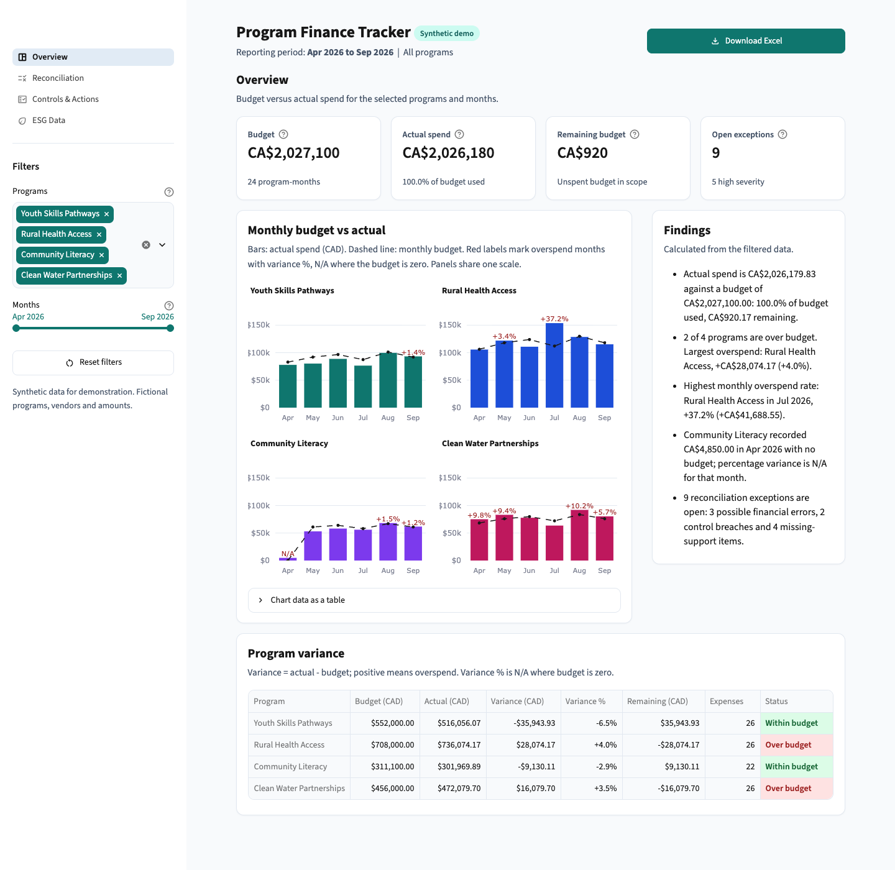
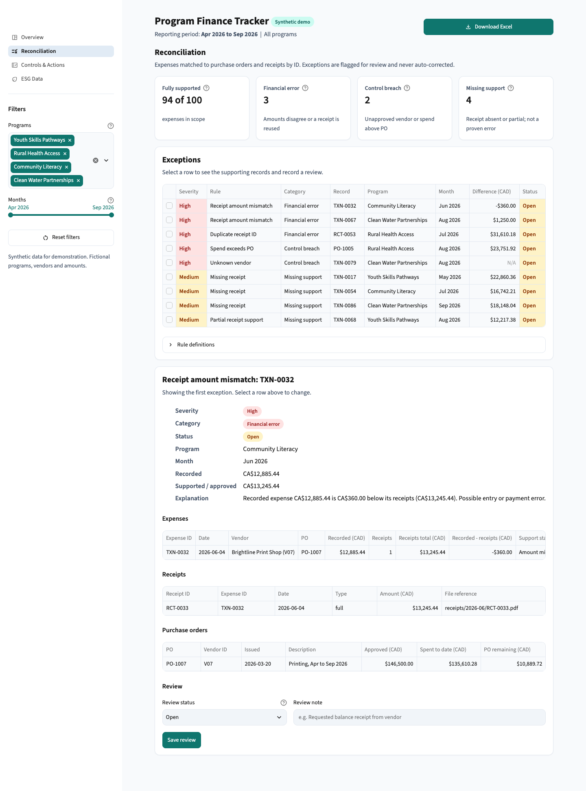

# Program Finance Tracker

A small finance-operations demo for a fictional nonprofit. It is built with Python, Streamlit,
pandas, SQLite, Plotly and openpyxl. It tracks program budgets against actual spend, matches
expenses to purchase orders and receipts, keeps a control-evidence checklist with change
history, and checks a small set of ESG indicators for data-quality problems.

> **Synthetic data only.** Every program, vendor, person, amount and indicator is invented.
> This is a portfolio demo, not a production system. It has not been audited, has no
> real users, and is not a certified internal-control or ESG reporting tool.



## Quick start

Requires Python 3.11 or newer (developed on 3.12).

```bash
python3 -m venv .venv
source .venv/bin/activate          # Windows: .venv\Scripts\activate
pip install -r requirements.txt
streamlit run app.py               # creates and seeds data/finance_demo.db on first run
```

Other commands:

```bash
python -m pft.seed            # seed only if the database is empty
python -m pft.seed --reset    # rebuild from scratch (also clears review statuses and history)
python -m pytest              # run the test suite
```

## What the app does

| Page | Contents |
|---|---|
| **Overview** | Program and month filters; Budget, Actual spend, Remaining budget and Open exceptions cards; budget-vs-actual chart by program and month; findings calculated from the filtered data; program variance table with program-month detail |
| **Reconciliation** | Expenses matched to POs and receipts by ID. Six exception rules, each with severity, category and status. Selecting a row shows the expense, receipt and PO records behind it. Review statuses are saved with history |
| **Controls & Actions** | Checklist with control, evidence reference, owner, due date, status and notes. Status and note changes are saved to SQLite with a timestamped change history. Labelled as a demo workflow |
| **ESG Data** | Office electricity use (kWh) and training participation (participants), each with definition, unit, period, source, owner and verification status. Flags missing values, missing sources and inconsistent units |

**Download Excel** in the header builds a workbook for the current filters. It has six sheets:
Summary, Budget vs Actual, Reconciliation Exceptions, Control Evidence, ESG Data and Data
Dictionary. Currency columns have number formats, and every data sheet has filters, frozen
headers and a scope line.

### Calculation rules

- Amounts are stored and calculated as **integer CAD cents**. They are converted to dollars only for display and export.
- **Variance = actual − budget.** A positive variance means overspend.
- **Remaining = budget − actual.**
- **Variance %** = variance / budget. It shows as **N/A** when the budget is zero. The seed data includes such a month: Community Literacy has a zero April budget but has spend.
- Budgets and transactions are separate tables. Transactions are summed to program-month **before** being joined to budgets, so a budget is never repeated once per expense.
- Every page and the Excel export use the same filtered `Report` object (`pft/report.py`), so the UI and the export cannot drift apart.

### Reconciliation rules

| Rule | Category | Severity | Seeded example |
|---|---|---|---|
| Missing receipt | Missing support | Medium | 3 expenses |
| Partial receipt support (receipts marked partial cover less than the expense) | Missing support | Medium | 1 expense |
| Receipt amount mismatch (summed full receipts ≠ recorded amount) | Financial error | High | 2 expenses |
| Duplicate receipt ID (one receipt supports two expenses) | Financial error | High | RCT-0053 |
| Unknown vendor (not in the vendor master) | Control breach | High | 1 expense |
| Spend exceeds PO | Control breach | High | PO-1005 |

Receipts are summed per expense before the comparison. The seed data has two expenses paid in
two instalments, and they match. Missing support is reported separately from financial errors:
a missing receipt means the evidence is incomplete, not that the amount is wrong. Flagged
expenses stay in actual spend as recorded. The app never corrects or removes them.

## Project layout

```
app.py                     Streamlit entry point: filters, header, navigation
pft/
  db.py                    SQLite schema and connection
  seed.py                  deterministic synthetic data (python -m pft.seed)
  money.py                 cents formatting and percentage variance
  data.py                  table loading and the filter Scope
  metrics.py               budget vs actual, totals, findings
  reconciliation.py        matching and exception rules
  controls.py              control/exception updates and change history
  esg.py                   ESG validation
  report.py                one Report object shared by UI and export
  export.py                Excel workbook
  pages.py, ui.py          page rendering and styling
tests/                     pytest suite, including a Streamlit AppTest UI check
powerquery/                Power Query (M) import example with sample CSV
docs/procedures.md         one-page monthly review procedure
docs/process-diagram.svg   process diagram (plain SVG, importable into Visio)
.streamlit/config.toml     light theme
```

## Tests

`python -m pytest` runs 31 tests. They cover:

- totals that match the raw tables, overall and per program
- no budget duplication from the join, compared against a naive join that does duplicate
- zero-budget months showing N/A, in the calculations, the findings and Excel
- each seeded exception rule, receipt summing for split receipts, and flagged spend still counted in actuals
- control and exception updates surviving a new database connection, with appended timestamped history and no-op saves that write nothing
- ESG flags, missing values that stay blank (never zero), and units that are not converted
- Excel and UI agreement: workbook totals and row counts compared with the report for the full scope and a filtered scope. A Streamlit `AppTest` run of `app.py` applies filters and compares the KPI cards with the workbook's Summary sheet
- filter reset and the empty state when no programs are selected

## Other deliverables

- **Power Query:** [`powerquery/import_expenses.pq`](powerquery/import_expenses.pq) imports [`sample_expenses.csv`](powerquery/sample_expenses.csv), sets types and labels invalid rows. Instructions are in [`powerquery/README.md`](powerquery/README.md). No Power BI file is included.
- **Procedures:** [`docs/procedures.md`](docs/procedures.md) covers refresh, variance review, receipt matching, exception escalation and evidence updates.
- **Process diagram:** [`docs/process-diagram.svg`](docs/process-diagram.svg) is plain SVG shapes and text, which Visio can import. It was not created in Visio and is not a `.vsdx` file.



## Limitations

- Single user, local only. There is no authentication; history entries are attributed to "demo user".
- Data comes only from the seed script. The app has no import of real ledger, bank or receipt files, and evidence references are fictional identifiers, not stored documents.
- Exception rules are deliberately simple: exact ID matching, exact amount comparison, one PO per program-vendor pair. There is no tolerance threshold, fuzzy vendor matching or currency conversion.
- Review statuses are recorded but do not drive any approval workflow. Resolving an exception does not change the underlying data.
- ESG indicators are two synthetic operational measures. They are not impact metrics, not audited, and not mapped to any reporting framework.
- Overdue controls are judged against a fixed reporting date (2026-09-30) to match the synthetic period.
- The Power Query script has not been run in Excel or Power BI in this repository.
- The interface is light-theme only. It was checked at 375, 768, 1024 and 1440px in Chromium. It has not been tested with a screen reader.

## Design review

The visual pass used the [ui-ux-pro-max](https://github.com/nextlevelbuilder/ui-ux-pro-max-skill)
skill's search tool. It recommended a "Minimalism & Swiss" style for a dense finance dashboard,
which matches the existing design.

Changes made from its guidance:
- **Focus states:** a solid teal focus outline (about 5.4:1 against white) replaces Streamlit's faint default ring.
- **Captions:** solid muted text instead of 60% opacity, to keep contrast above 4.5:1.
- **Badges:** status badges no longer wrap onto a second line.
- **Reduced motion:** the `prefers-reduced-motion` setting is respected.
- **Chart table:** the chart has a table view of the same figures, its accessible fallback.
- **Empty states:** they offer a Reset filters button in place, since the sidebar is collapsed on phones.
- **Medium widths:** at 641 to 1199px the KPI cards form a 2×2 grid and the findings move below the chart.

Not adopted: its dark palette, Lexend headings and landing-page layout. They conflict with this
project's light-only, Source Sans 3 brief. Its waterfall-chart suggestion for budget variance was
also left out, to keep to a single comparison chart.
