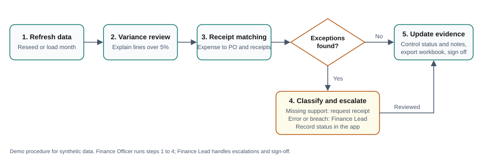

# Monthly finance review procedure (demo)

**Scope:** the Program Finance Tracker demo, which uses synthetic data only. The steps show
how a small nonprofit finance team might use the tool. This is not an approved policy or a
certified internal-control procedure. **Roles:** the Finance Officer (FO) prepares; the
Finance Lead (FL) reviews, escalates and signs off; program managers (PM) explain variances
and supply receipts.

## 1. Refresh (FO, first business day)
1. Run `python -m pft.seed` to create the database if it is missing. Run
   `python -m pft.seed --reset` to rebuild it. **Reset deletes all review statuses and
   change history.**
2. Start the app with `streamlit run app.py`. Check that the header shows the expected
   reporting period and that **Reset filters** selects all programs and months.

## 2. Variance review (FO prepares, PM explains)
1. On **Overview**, read the four KPI cards, then the program variance table.
   Variance = actual − budget, so a positive number is overspend.
   Remaining = budget − actual.
2. For any program-month over budget by more than 5%, the PM records an explanation
   on the matching *Monthly budget-vs-actual sign-off* control.
3. A month with no budget but with spend shows its variance % as **N/A**. Confirm the
   spend was approved, and whether a budget should be added.

## 3. Receipt matching (FO)
1. Open **Reconciliation**. Each expense is matched to its PO and receipts by ID.
   Receipts are summed before the comparison, so instalment receipts that add up to the
   expense count as matched.
2. Select each exception and read its supporting records (expense, receipts, PO). The app
   flags problems but never changes the underlying amounts.

## 4. Exception escalation
| Category | Rules | Action | Owner and timing |
|---|---|---|---|
| Missing support (Medium) | Missing receipt, partial receipt support | Request the receipt or balance receipt; set status to *Under review* | FO → PM, 5 business days |
| Financial error (High) | Receipt amount mismatch, duplicate receipt ID | Escalate; check the payment against the bank record; correct it in the source ledger, not in this tool | FL, 2 business days |
| Control breach (High) | Unknown vendor, spend exceeds PO | Escalate; approve the vendor or PO amendment, or reverse the spend | FL, 2 business days |

Set an exception to **Resolved** only after the cause is fixed at source. Record what was
done in the review note. Resolved exceptions stay listed for audit trail purposes.

## 5. Evidence updates and close (FO, FL)
1. On **Controls & Actions**, update each control's status and notes. Notes should name
   the evidence document, for example `EVD-BVA-2026-09`. Every save writes a timestamped
   entry to the change history.
2. Click **Download Excel** with the filters set to the reporting scope. The workbook's
   Summary sheet records that scope. File it with the month's evidence.
3. The FL reviews any open High exceptions and overdue controls, then signs off the
   *Monthly budget-vs-actual sign-off* control.
